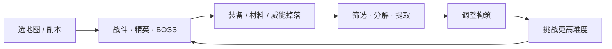

# 产品定位：暗黑式刷宝，借 DNF 的手感

> **一句话**：2.5D 横版战斗表现，暗黑式的随机装备与赛季结构，单人能完整玩，不做 MMO 的日常。

## 结论

| 项 | 选择 |
|---|---|
| 类型 | 2.5D Seasonal ARPG（赛季制动作刷宝） |
| 战斗表现 | 借 DNF 的横版打击感、技能连招、动作反馈 |
| 装备与成长 | 学暗黑 / 流放之路：随机词缀、传奇机制、自由构筑 |
| 赛季长度 | 10～12 周；当前按 **12 周** 设计 |
| 多人 | 可组队，但单人内容完整；不做强制团本 |
| 商业化/在线 | 不靠体力、日常、次数来制造上线压力 |

**这不是 MMO。** 只是穿了 DNF 那层 2.5D 动作外衣的暗黑式 ARPG。

## 明确不做的东西

这些是「班味」的来源，也是这次定位里最该守住的反面清单：

- 每日任务、周常、签到式的成长效率。
- 体力、副本次数、每日收益上限。
- 固定时间组队、固定团、团本进度决定装备成长。
- 大量材料 + 每日副本 + 概率强化 + 失败惩罚的组合。
- 公会战、强制社交、为了活跃度把玩家留在线上。
- 依赖玩家劳动的经济系统（搬砖、拍卖行打工）。

原则只有一句：**玩家上线是因为想刷，不是因为今天还有任务没完成。**

## 核心循环

这个循环不应该被日常任务打断。副本随时进、随时退，可以重复刷。

## 赛季给的是目标，不是任务清单

| 赛季目标 | 玩法 | 说明 |
|---|---|---|
| 装备收集 | 收集赛季限定传奇 / 独特装备 | 有明确追求，但不规定每天刷几次 |
| 流派开发 | 尝试不同技能与装备组合 | 鼓励开第二、第三套构筑 |
| 深渊挑战 | 挑战不断提升的怪物强度 | 层数 / 难度自选 |
| BOSS 狩猎 | 针对性刷特定装备 | 定向掉落，但不保底到失去随机性 |
| 极限挑战 | 限时通关、无伤、低装等挑战 | 给硬核玩家 |
| 收藏成就 | 图鉴、稀有掉落、外观 | 长期目标 |

这些都应该是**可选目标**。玩家想冲就冲，不想冲也不损失成长。

## 必须控制的三个系统

### 1. 体力：不做

不要出现「今天体力用完了」「今天副本次数用完了」「今天没收益了」。
用怪物强度、掉落效率、难度选择来控制节奏，而不是限制游戏时间。

### 2. 强化：不做，只保留洗练

这是后来明确收敛的决定：**取消装备强化等级，只保留词缀洗练。**

| 做 | 不做 |
|---|---|
| 用洗练调整装备词缀 | 装备 +1～+15 的强化等级 |
| 传奇 / 传承威能改变构筑 | 大量强化材料 + 每日副本 |
| 极品主要通过刷取获得 | 概率失败、掉级、碎装备 |
| 装备本身有独立价值 | 装备只是「底材 + 强化等级」的壳 |

这样装备养成集中在：随机词缀、威能获取与拓印、词缀洗练、独特装备、套装组合，而不是反复加工同一件装备。
洗练的具体范围（只改数值，还是也能改词缀类型）仍待定，见 [05-装备与威能规则.md](05-装备与威能规则.md)。

### 3. 社交：增强体验，不是成长前提

| 做 | 不做 |
|---|---|
| 单人完整刷图 | 强制组队才能推进度 |
| 好友自由组队 | 固定团、每日团本 |
| 多人挑战特殊 BOSS | 公会战、团队考勤 |
| 非强制排行榜 | 排行榜绑定核心奖励 |
| 有限度交易（待定） | 无限制交易威能 / 搬砖经济 |

## 产品原则

| 维度 | 原则 |
|---|---|
| 战斗 | DNF 式打击感、技能连招、动作反馈 |
| 装备 | 暗黑式随机词缀、传奇机制 |
| 成长 | 自由构筑，不强制固定职业路线 |
| 副本 | 可重复挑战、难度递进 |
| 赛季 | 10～12 周，阶段性目标 |
| 社交 | 轻社交、可选组队 |
| 经济 | 不依赖 MMO 式玩家劳动经济 |
| 时间 | 不制造每日上线压力 |

## 开发优先级

1. 战斗手感和技能系统。
2. 装备词缀与传奇特效系统。
3. 流派之间的差异化。
4. 副本和难度递进系统。
5. 赛季内容与长期追求。

第一版不要做几十个副本、几百件装备。最终职业口径是 **6 个职业 × 3 条专精分支**，但首版先做 **剑修、机巧、御灵 3 条端到端**，验证「装备驱动构筑」这件事成立，再扩另外 3 个职业。

## 待定

- **赛季 10 周还是 12 周**：讨论里两个数都出现过；当前按 12 周排，压缩到 10 周时需要重排毕业曲线。
- **交易开不开**：规则上「被玩家修改过或人造的装备不可交易」已确定，但第一版是否开放交易仍未定。
