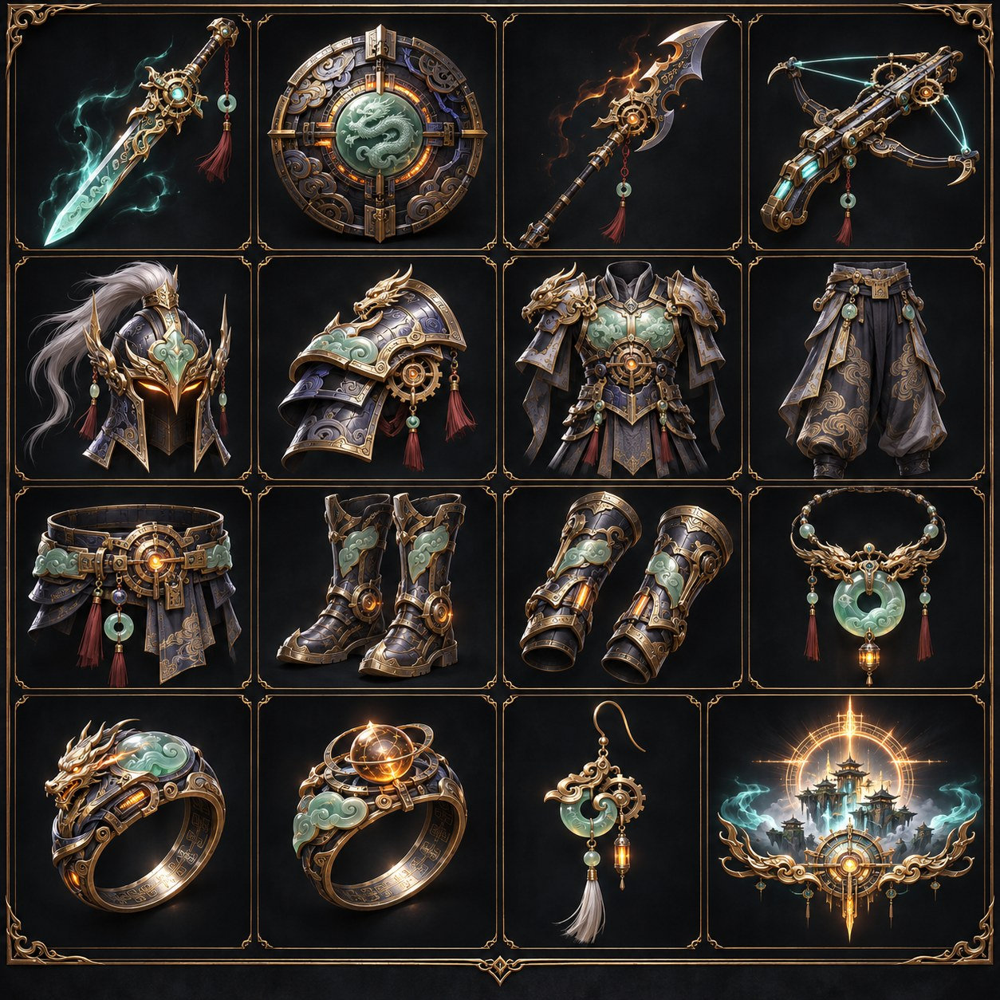

# 装备体系：16 个槽位与三层价值

> **结论**：项目实际采用 **16 个槽位**（武器 4 + 防具 7 + 首饰 4 + 称号 1）。
> 早期讨论过 15 个逻辑槽位的方案，落到项目配置时演变成了现在的 16 槽。
> 比槽位数量更重要的是：**每个槽位有自己的词缀职责，装备要能改变玩法，而不只是加数值。**

*示意图，按 16 槽重新生成，不是游戏内 UI。*

## 一、当前口径：16 槽

| 分组 | 槽位 | 数量 |
|---|---|---:|
| 武器 | 主手、副手、备用武器 1、备用武器 2 | 4 |
| 防具 | 头部、护肩、上衣、下装、腰带、鞋子、护腕 | 7 |
| 首饰 | 项链、戒指 1、戒指 2、耳环 | 4 |
| 特殊 | 称号 | 1 |
| **合计** | | **16** |

### 和早期 15 槽方案的关系

早期提案是 15 个**逻辑槽位**：

- 防具 7：头盔、肩甲、胸甲、护腕、腰带、裤子、鞋子
- 首饰 4：项链、戒指 ×2、耳环
- 武器 2：主手、副手
- 特殊 2：护符、圣物

现在的 16 槽 = 15 槽 **减去护符/圣物，加上称号和两个备用武器位**（15 − 2 + 3 = 16）。

> 整理时的判断，待确认：护符、圣物原本承担的「特殊机制」职责，现在由第二、三层威能（道统 / 传承）承担，所以不再单独占槽；称号则是新增的全局位，具体给什么词缀还没定。

## 二、槽位组与武器组

| 槽位组 | 包含 | 用途 |
|---|---|---|
| `weapon` | 主手、副手 | 当前战斗武器 |
| `weapon_alt` | 备用武器 1、2 | 第二套武器，切换用 |
| `armor` | 头、肩、衣、裤、腰、鞋、腕 | 防具 |
| `accessory` | 项链、戒指 ×2、耳环 | 首饰 |
| `special` | 称号 | 特殊位 |

两个硬规则：

1. **只有当前激活的武器组参与属性、词缀和威能计算。** 备用组不叠加。
2. **双手武器占用主副手，由武器定义声明占用关系**，不是简单允许两个槽位各穿一件。

## 三、每个槽位管什么

这是让「刷某个部位」有意义的关键。不要让 16 个槽位共用同一个词缀池。

| 槽位 | 词缀与属性侧重点 |
|---|---|
| 武器（主/副/备用） | 基础伤害、攻击速度、技能机制、伤害类型 |
| 头部 | 技能等级、资源、冷却缩减 |
| 护肩 | 攻防混合、技能强化 |
| 上衣 | 生命、防御、减伤 |
| 护腕 | 攻速、格挡、技能效果 |
| 腰带 | 生命、药剂效果、资源恢复 |
| 下装 | 防御、抗性、生命 |
| 鞋子 | 移速、闪避、特殊移动 |
| 项链 | 全局技能、核心伤害 |
| 戒指 | 输出、元素、特殊词缀 |
| 耳环 | 职业机制、特殊属性 |
| 称号 | 全局 / 赛季 / 声望向（待定） |

这样玩家刷装备时，不是单纯比较装等，而是会想：**「我需要的那条词缀，能不能在这个部位出？」**

## 四、装备的三层价值

装备分三层，越往下越接近「改变玩法」。

### 第一层：基础属性装备

解决角色数值成长。

- 武器：基础攻击力、攻击速度、暴击。
- 防具：生命、防御、抗性。
- 首饰：暴击、元素伤害、技能增伤。

玩家在开荒期主要追这一层。

### 第二层：流派构筑装备

解决「不同流派怎么玩得不一样」。

例：

- 火焰技能伤害提高 50%。
- 某技能变为冰霜属性。
- 闪避后下一次攻击必定暴击。
- 召唤物继承角色 30% 攻击速度。
- 某技能增加两次充能，但伤害降低。

### 第三层：特殊机制装备

解决后期追求和组合深度。

例：

- 释放技能时有概率触发另一个技能。
- 生命低于 30% 时进入狂暴状态。
- 暴击时产生连锁闪电。
- 消耗生命代替魔力释放技能。
- 将所有火焰伤害转化为毒素伤害。

> 这三层不是装备品质的三个等级。普通传奇也可能带第三层机制，独特装备则固定带一个不可替换的机制。品质、层级、装等是三件不同的事。

## 五、传奇、套装、独特

| 类型 | 设计原则 |
|---|---|
| 传奇装备 | 有固定的独特效果；效果最好是「改变技能行为」，不是纯数值 |
| 独特装备 | 天生携带一个**无法拓印、不可替换**的强大固定威能；是构筑核心，不是「多一条词缀」 |
| 套装 | 本质上也是威能，只是多了件数激活条件；有 2/4/6 件档，多数与职业强绑定，少数跨道统 |
| 普通/稀有 | 提供底材、随机词缀和威能载体，是大量掉落的主体 |

套装不要做成固定答案。传统「2 件 +20% 伤害、4 件 +50% 伤害」的问题是：玩家只会选数值最高的那一套。更值得做的是让套装改变技能形态，或者提供跨职业组合。

套装的三档建议：

- 2 件：激活一个通用或职业威能。
- 4 件：激活一个专精绑定的核心威能。
- 6 件：改变某个技能的核心机制，或提供跨道统组合。

> 套装威能不是「第四层」，它仍然属于天地 / 道统 / 传承三层，只是额外加了「穿够几件」的激活条件。

## 六、词缀：生成规则与生效规则分开

刷装备时有两条独立的规则，不能混：

| 规则 | 管什么 | 例子 |
|---|---|---|
| 词缀生成 | 这件装备能出哪些属性、出几条 | 上衣不出暴击；戒指最多 4 条；同类属性最多 1 条 |
| 属性生效 | 全身累计后，超出上限的部分怎么办 | 暴击率堆到 120%，只有 100% 生效 |

即使玩家已经有 120% 暴击率，副本仍然可以掉暴击率戒指；它只是对当前角色「超出部分没收益」，不是非法装备。

具体分类、部位配额、上限与递减规则见 [07-词缀与属性上限.md](07-词缀与属性上限.md)。

## 六、掉落与毕业的关系

- 高难度提高**效率**，不垄断极品：普通副本也有机会出极品，高难度只是概率更高。
- 核心传奇要有相对稳定的获取渠道，避免「一件装备不掉，整个流派不成立」。
- 重复装备可以分解成材料，材料可以定向兑换特定部位。
- 极品词缀仍然主要靠随机掉落，保留长期追求。

具体数值和算法见 [05-装备与威能规则.md](05-装备与威能规则.md)，词缀生成与属性上限见 [07-词缀与属性上限.md](07-词缀与属性上限.md)。

## 待定

- 称号到底给什么：全局属性？赛季声望？还是纯收集？
- 备用武器位是否所有职业都有，还是只有部分职业（如剑修、机巧）开放？
- 护符/圣物是否彻底并入威能系统，还是以后以「第四层」形式回来？
