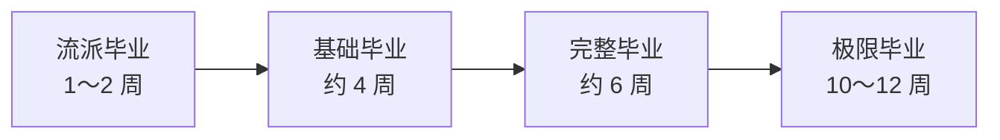

# 赛季与毕业节奏

> **结论**：12 周一个赛季。普通玩家 **4～6 周基础毕业**，核心玩家 2～3 周成型，重度玩家 8～12 周追极限。
> 毕业不是「所有装备都理论最优」，而是分层的：流派毕业 → 基础毕业 → 完整毕业 → 极限毕业。

## 一、12 周怎么排

| 阶段 | 时间 | 玩家在做什么 |
|---|---|---|
| 开荒期 | 第 1 周 | 解锁玩法、升等级、确定这赛季玩什么 |
| 构筑期 | 第 2 周 | 核心装备与技能流派成型 |
| 成长期 | 第 3～4 周 | 装备逐步完善，开始刷高难度 |
| 毕业期 | 第 5～6 周 | 核心装备基本毕业 |
| 追求期 | 第 7～10 周 | 极品词缀、稀有装备、极品洗练、第二流派 |
| 收尾期 | 第 11～12 周 | 赛季挑战、排行榜、赛季奖励 |

### 三个毕业概念，不要混

| 概念 | 含义 |
|---|---|
| 流派毕业 | 核心装备、关键技能机制齐了，能正常打高难度 |
| 数值毕业 | 大部分装备达到目标品质，关键词缀基本正确 |
| 极限毕业 | 词缀接近理论上限，洗练与威能收藏基本完成 |

普通玩家的「毕业」应该指前两个。极限毕业是给重度玩家的长期目标，不是所有人都必须达到的门槛。

## 二、按每日投入时间排

| 玩家类型 | 每日游戏时间 | 基础毕业 | 极限毕业 |
|---|---:|---|---|
| 休闲玩家 | 0.5 小时 | 8～10 周 | 不强求 |
| 普通玩家 | 1～2 小时 | 4～6 周 | 10～12 周 |
| 活跃玩家 | 3～4 小时 | 2～3 周 | 6～8 周 |
| 重度玩家 | 6 小时以上 | 1～2 周 | 4～6 周 |

这是设计目标，不是行业标准。核心是：**普通玩家能在一个赛季内体验完整构筑，重度玩家有足够长的极品追求空间。**

## 三、双层毕业

### 第一层：构筑毕业（4～6 周）

玩家能体验完整的职业流派，拥有核心装备和关键技能机制。
这一层结束时，玩家应该已经能打赛季的大部分内容。

### 第二层：追求毕业（8～12 周）

追求极限词缀、稀有传承、词缀上限、排行榜成绩。

两层之间必须补东西，否则玩家会在第 6 周没事做。可用的「第二层燃料」：

- 更高难度的副本与深渊层数。
- 特殊词缀组合、稀有传承。
- 职业的第二套、第三套流派。
- 极限输出挑战、竞速。
- 赛季专属装备收藏。
- 排行榜。

## 四、装备掉落怎么控制毕业时长

建议把毕业拆成几个可量化的目标（示意，不是每件装备逐项计算）：

| 毕业目标 | 目标完成度 | 说明 |
|---|---:|---|
| 核心装备收集 | 100% | 能组成完整流派 |
| 装备品质 | 90% | 主体装备达到目标品质 |
| 核心词缀 | 80% | 关键词缀基本正确 |
| 普通词缀 | 70% | 不要求全部完美 |
| 关键词缀数值 | 80% | 洗练到较高档位，不要求满值 |
| 极品词缀 | 30% | 保留长期追求空间 |

### 防「运气卡死」

最重要的一条：**不要让某一件装备始终不掉，导致整个流派不成立。**

| 机制 | 作用 |
|---|---|
| 重复装备分解成材料 | 垃圾掉落也有价值 |
| 材料定向兑换特定部位 | 非酋保底 |
| 核心传奇有稳定获取渠道 | 流派关键件不至于绝版 |
| 普通词缀可洗练 | 减少「词缀全歪」的挫败 |
| 极品词缀仍靠随机 | 保留刷宝惊喜 |

## 五、三层威能天然对应赛季节奏

如果采用三层威能体系（见 [04-修仙世界观职业映射.md](04-修仙世界观职业映射.md)），赛季阶段可以自然对上：

| 赛季阶段 | 主要获取 | 玩家成长 |
|---|---|---|
| 开荒期 | 第一层：通用威能 | 基础属性逐步提高 |
| 构筑期 | 第二层：道统威能 | 职业核心机制成型 |
| 成型期 | 第三层：传承威能 | 流派玩法发生变化 |
| 毕业期 | 高品质威能组合 | 优化词缀和数值 |
| 追求期 | 极品传承、跨道统套装 | 尝试新构筑、追极限 |

但**不要把三层做成严格的掉落等级**。不能规定「必须先集齐所有第一层，才掉第二层」。更好的做法是：

- 前期第一层出现概率高。
- 中期第二层逐渐成为主要目标。
- 后期第三层渠道变多。
- 高难度提高稀有威能效率。
- 玩家始终能用材料、定向掉落去追特定构筑。

## 六、比「刷同一套装备」更重要的东西

赛季留存不应该只靠「把同一套装备的词缀从 80 分刷到 95 分」。

假设一个职业有 4 套真正有玩法区别的流派：

- 第一套：第 2 周成型。
- 第二套：第 4 周成型。
- 第三套：第 6 周成型。
- 第四套：第 8 周成型。

这比让玩家用 8 周刷同一套的极品词缀更有吸引力，因为玩家始终在体验新的战斗方式。

## 待定

- **10 周还是 12 周**：如果压缩到 10 周，追求期要砍到 6～8 周，基础毕业目标也要提前。
- **赛季继承规则**：威能收藏跨赛季怎么继承、继承多少，直接影响新赛季开荒长度（见 05）。
- **洗练范围**：只改数值还是也能改词缀类型，会直接影响毕业难度；强化体系已确定不做。
