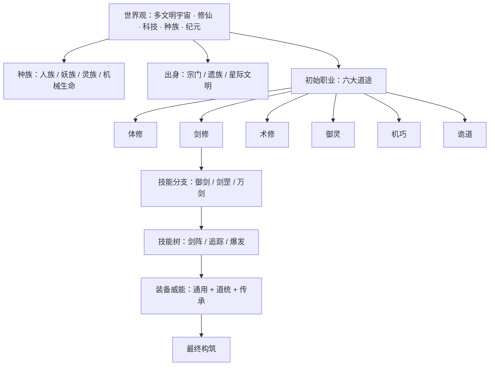

# 修仙世界观下的职业映射：六大道途与三层威能

> **结论**：从 DNF / 暗黑提炼的 14 种原型、8 职业中间方案，最终收敛成 **6 条修行道途**（体、剑、术、御灵、机巧、诡道），
> 用 **种族 / 出身 / 初始职业 / 技能分支 / 装备传承** 五个独立维度搭角色，
> 用 **通用 → 道统 → 传承** 三层威能承担「装备改变玩法」。
> [03-职业体系.md](03-职业体系.md) 负责推导与合并过程，本篇负责世界观、六道途、三层威能与跨职业规则；两份冲突时以本篇的“最终口径”为准。

*示意：体修、剑修、术修、御灵、机巧、诡道。图片为重新生成，不是分享页原图。*

## 一、底层世界观

不是纯修仙，也不是纯科技修仙，而是：

**多文明宇宙背景 + 修行体系 + 科技造物 + 多种族共存。**

可以理解成一个已经经历过漫长文明演化的修行世界。它能同时装下：

- 传统仙侠：宗门、仙门、灵根、洞府、秘境、剑修、丹道、阵法。
- 科幻修仙：星际文明、机械飞升、灵能科技、基因改造、人工灵根。
- 东方奇幻：妖族、灵族、魔族、龙族、异兽、上古遗族。
- 暗黑式内容：远古遗迹、禁忌传承、深渊、异界、古神、污染。
- 赛季内容：不同纪元、文明遗迹、世界灾变、特殊修行法则。

### 五个独立维度

不要把种族、职业、技能、装备全部塞进「职业」一个概念里。

| 维度 | 决定什么 | 举例 |
|---|---|---|
| 种族 | 生物基础、天赋、文化 | 人族、妖族、灵族、机械生命 |
| 出身 | 初始背景、世界关系 | 宗门弟子、星际遗民、古族后裔 |
| 初始职业 | 战斗基础、资源、武器 | 体修、剑修、术修 |
| 技能分支 | 核心战斗方式 | 血煞、御剑、雷法 |
| 装备传承 | 构筑方向、技能机制 | 血神传承、万剑归宗、天雷道体 |

好处：

1. 同一种族可以选不同职业。
2. 同一职业可以发展出完全不同的玩法。
3. 科技和修仙可以同时存在于一个职业里。
4. 后期加种族、分支、技能树、装备，不用推翻基础架构。

例如：机械生命也可以修剑道；人族也可以通过机械改造成为机械飞升者。这比「人族战士、妖族法师、机械族枪手」灵活得多。

## 二、六大道途

| 道途 | 定位 | 主要来源 | 核心 | 三个分支 |
|---|---|---|---|---|
| 体修 | 近战力量型 | DNF 狂战士、散打、柔道；暗黑野蛮人、部分武僧 | 肉身、气血、骨骼、经脉；近身、爆发、硬直、抓取、承伤 | 血煞、金刚、破军 |
| 剑修 | 高速武器型 | DNF 剑魂、剑帝、剑影；暗黑刺客武术、武僧 | 剑意、剑气、飞剑、剑阵；连击、剑技组合、远近切换 | 御剑、剑罡、万剑 |
| 术修 | 远程法术型 | DNF 元素师、冰结师、元素爆破师；暗黑法师、巫师 | 灵力、元素、法则、符文；法术组合、范围控制、爆发 | 五行、雷法、冰魄 |
| 御灵 | 召唤控制型 | DNF 召唤师、死灵术士；暗黑死灵法师、德鲁伊、巫医 | 灵兽、亡灵、契约、生命形态；召唤、持续作战、协同 | 灵兽、亡灵、化形 |
| 机巧 | 部署操控型 | DNF 机械师、枪炮师；暗黑恶魔猎手炮塔/陷阱 | 灵械、机关、傀儡、阵列、能量武器；部署、自动攻击、战场控制 | 灵械、傀儡、天工 |
| 诡道 | 高机动技巧型 | DNF 刺客、影舞者、忍者、特工；暗黑刺客、游侠陷阱 | 隐匿、幻术、毒、空间穿梭、暗器、陷阱；机动、标记、背击、爆发 | 影杀、毒蛊、幻阵 |

### 六种不同的战斗行为

这六个不是六种属性，而是六种「玩家在干什么」：

- **体修**：自己冲进去打。
- **剑修**：用武器和剑气连击。
- **术修**：操纵法则放法术。
- **御灵**：通过其他生命单位作战。
- **机巧**：部署造物构建战场。
- **诡道**：通过位置、状态和时机制造伤害。

这样职业之间才有真正的操作差异。

## 三、为什么不把科技和修仙分成两套职业

不要做成：

- 修仙职业：剑修、法修、体修。
- 科技职业：枪手、机械师、机甲师。

这会把职业拆成两套独立体系，最后还是玩法重复。更好的做法是：**同一个修行体系，允许不同的力量表现形式。**

| 修行体系 | 传统修仙 | 科技修仙 |
|---|---|---|
| 体修 | 气血、金身、锻骨 | 基因强化、纳米灵躯 |
| 剑修 | 飞剑、剑气、剑阵 | 灵能飞剑、量子剑阵 |
| 术修 | 五行、雷法、冰魄 | 能量场、粒子操控 |
| 御灵 | 灵兽、魂体、妖灵 | 生物兵器、人工灵体 |
| 机巧 | 机关兽、傀儡、阵法 | AI 灵械、无人机、机甲 |
| 诡道 | 隐身、毒蛊、幻阵 | 光学隐形、纳米毒素、空间装置 |

这样某个赛季引入机械飞升文明时，不需要新增一套职业，只要新增科技传承、技能分支和装备威能。

## 四、三层装备威能

这是整套系统的底层原则：

**第一层：天地通用威能（Universal）**
全职业共享。负责基础数值、通用战斗机制、基础输出与生存。

- 攻击：暴击、攻速、伤害、穿透
- 防御：生命、护盾、减伤、抗性
- 功能：冷却、资源、移速、范围

**第二层：道统专属威能（Archetype）**
同一职业的多个分支共用。负责职业核心机制、资源循环、战斗方式强化。
例如剑修的飞剑数量、剑意恢复、剑气穿透；体修的气血转化、怒气获取、近战震荡。

**第三层：传承专属威能（Specialization）**
针对某个具体技能分支甚至某个技能。负责改变技能形态、机制、核心输出循环。
例如飞剑分裂、剑阵自动追踪、剑气变持续激光、血煞技能消耗护盾而非生命。

| 层级 | 玩家获得什么 | 主要解决什么 |
|---|---|---|
| 第一层 | 基础数值、通用机制 | 角色成长 |
| 第二层 | 职业机制强化 | 职业深度 |
| 第三层 | 流派机制改变 | 构筑差异 |

> **三层不是装备品质的三个等级，而是威能适用范围的三个等级。**
> 第三层不一定比第一层数值大，也不一定更稀有，它们承担不同职责。

## 五、剑修实例：一个技能，四种玩法

假设玩家选择：

- 初始职业：剑修
- 技能分支：御剑道
- 技能树：万剑流
- 核心技能：万剑归宗

构筑不是一开始就定死，而是通过装备逐渐形成。

### 第一层：通用威能

| 威能 | 效果 |
|---|---|
| 暴烈 | 暴击伤害提高 |
| 迅捷 | 攻击速度提高 |
| 洞察 | 技能冷却缩减 |
| 灵脉 | 灵力恢复提高 |
| 破甲 | 攻击无视部分防御 |
| 充盈 | 最大生命提高 |
| 贯通 | 投射物穿透次数增加 |

体修可以用迅捷，剑修可以用暴烈，术修可以用洞察。

### 第二层：剑修道统威能

| 威能 | 效果 |
|---|---|
| 剑意流转 | 使用剑技获得剑意 |
| 养剑术 | 飞剑攻击时恢复剑意 |
| 剑气纵横 | 剑系技能范围增加 |
| 御剑通灵 | 飞剑攻击速度提高 |
| 剑势叠加 | 连续命中提高剑系伤害 |
| 万剑归元 | 剑意满时强化下一次剑技 |

无论选御剑、剑罡还是万剑，都能从这些威能受益。玩家不会因为换分支，就浪费之前积累的剑修装备。

### 第三层：万剑流专属威能

| 威能 | 效果 |
|---|---|
| 万剑分光 | 万剑归宗释放时剑影数量增加 |
| 剑阵共鸣 | 飞剑命中后触发剑阵追加攻击 |
| 追魂剑意 | 飞剑自动追踪被标记目标 |
| 剑海无涯 | 持续时间增加，但单剑伤害降低 |
| 剑影化身 | 释放时生成一个同步攻击的剑影 |

这些不应该全是伤害加成。真正有价值的是改变技能行为：

| 形态 | 表现 |
|---|---|
| 基础形态 | 召唤飞剑，对周围敌人连续攻击 |
| 剑阵流 | 飞剑组成剑阵，持续攻击指定区域 |
| 追魂流 | 飞剑追踪标记目标，集中单体 |
| 剑影流 | 剑影化身与角色同步释放剑技 |

这才是装备驱动构筑的乐趣：不是把伤害从 100 提到 200，而是让玩家从一种玩法变成另一种玩法。

## 六、三层威能怎么分布到装备

不要规定「通用只能出现在普通装备、职业只能出现在职业装备、技能只能出现在套装」，那会把装备位置和构筑绑死。

| 装备来源 | 第一层 | 第二层 | 第三层 |
|---|---|---|---|
| 普通装备 | 可以 | 不出现或极少 | 不出现 |
| 稀有装备 | 可以 | 可以 | 不出现 |
| 传奇装备 | 可以 | 可以 | 可以 |
| 传承装备 | 可以 | 可以 | 高概率 |
| 特殊套装 | 可以 | 可以 | 核心效果 |

传承装备和特殊套装不应该成为唯一毕业路径。

- 一件普通传奇，可以同时有通用攻击词缀和剑修道统威能。
- 一件剑修传承，可以有剑修通用威能和万剑流专属威能。
- 一套万剑流套装，可以改变万剑归宗的技能机制。

玩家可以在不同部位自由组合，而不是被迫穿一整套。

## 七、套装：跨层级，不做固定答案

传统套装「2 件 +20% 伤害、4 件 +50% 伤害」的问题是：玩家只会选数值最高的那一套。

建议三种套装：

### 1. 道统套装

同一初始职业的多个分支都能用。例：剑宗六脉套装。

- 2 件：剑意获取提高。
- 4 件：剑系技能命中后获得额外剑势。
- 6 件：剑势满后触发一次剑气爆发。

适合第二层。

### 2. 传承套装

专门服务某个技能分支。例：万剑归宗套装。

- 2 件：万剑归宗增加飞剑数量。
- 4 件：飞剑命中后生成小型剑阵。
- 6 件：剑阵范围内飞剑获得追踪。

适合第三层。

### 3. 跨道统套装（最值得做）

不属于某个职业，允许多个职业使用。例：太虚天机套装。

- 2 件：召唤物、机关单位、投射物获得额外攻速。
- 4 件：所有自动攻击单位有概率触发额外攻击。
- 6 件：自动攻击单位获得连锁攻击。

于是：

- 剑修用飞剑。
- 御灵用灵兽。
- 机巧用无人机。

三个职业围绕同一套装备构筑，但玩法完全不同。这才产生跨职业的装备组合空间。

## 八、技能系统也分三层

不要让技能树承担所有构筑变化，否则技能树会越来越庞大。

| 层 | 内容 |
|---|---|
| 第一层：职业基础技能 | 所有剑修共享：普攻、位移、防御、基础剑技、剑意资源技能 |
| 第二层：职业通用技能 | 本职业全分支可用的被动、资源循环、通用强化 |
| 第三层：专精分支 | 选一个主修方向：御剑道、剑罡道、万剑道 |
| 第四层：分支技能树 | 分支内形成具体构筑：剑阵流、追踪流、爆发流、持续流 |
| 跨职业拓展 | 只能学目标职业树前若干层，消耗独立拓展点 |
| 装备威能介入 | 通用 + 道统 + 传承，共同决定最终战斗表现 |

重要规则：**玩家可以切换技能树，但不应该无限制地同时拥有所有技能树的完整能力。**

| 权限 | 规则 |
|---|---|
| 职业基础技能 | 永久开放 |
| 主修分支 | 完整解锁 |
| 副修分支 | 允许少量技能跨分支选取 |
| 专属技能树 | 用技能点形成不同组合 |
| 装备威能 | 允许跨分支甚至跨职业组合 |

这样既有职业身份，也有构筑自由度。

## 九、用三层威能控制赛季节奏

| 赛季阶段 | 主要获取 | 玩家成长 |
|---|---|---|
| 开荒期 | 第一层通用威能 | 基础属性逐步提高 |
| 构筑期 | 第二层道统威能 | 职业核心机制成型 |
| 成型期 | 第三层专属威能 | 流派玩法发生变化 |
| 毕业期 | 高品质威能组合 | 优化词缀和数值 |
| 追求期 | 极品传承、跨道统套装 | 尝试新构筑、追极限 |

但**不要把三层做成严格的掉落等级**。不能规定「先集齐所有第一层，才掉第二层」。更好的做法：

- 前期第一层概率高。
- 中期第二层逐渐成为主要目标。
- 后期第三层渠道变多。
- 高难度提高稀有威能效率。
- 玩家始终能用材料、定向掉落追特定构筑。

## 十、传承：把传奇装备包装成修行传承

| 装备概念 | 世界观包装 |
|---|---|
| 传奇装备 | 上古遗物 |
| 专属威能 | 功法传承 |
| 套装 | 宗门秘典、古代道统 |
| 特殊技能变化 | 神通变异 |
| 稀有装备 | 仙器、灵宝 |
| 科技装备 | 远古文明造物 |
| 特殊词缀 | 法则烙印 |

一件装备可以承载一段文明、一种修行理念，甚至一个消失的种族。例如：

- 机械文明的《万象天机录》：让飞剑变成自动化智能剑阵。
- 上古妖族的《九幽化形诀》：让召唤兽获得角色部分技能。
- 远古剑宗的《太虚剑典》：让普通剑技逐渐转化为飞剑攻击。
- 禁忌血族的《不灭血经》：让生命、护盾和攻击形成循环。

## 十一、整体蓝图

## 十二、已经拍板的三件事

### 1. 六大道途就是最终初始职业

不再压缩成五个，也不把诡道并进剑修或机巧。六个职业、每个 3 条专精分支，共 18 条分支；每条分支预留第 4 条扩展位，但首版不铺。

### 2. 跨职业：允许有限学习，不允许整棵树搬走

参考《最后纪元》的有限跨树，不是一个技能都不给，也不是随便学。

| 约束 | 规则 |
|---|---|
| 树深 | 只能学目标职业树的前若干层 |
| 点数 | 跨职业消耗独立拓展点，不挤占主修 |
| 前置 | 需要满足技能、装备、属性或任务条件 |

两种形式：

- **原技能继承**：拿到对方基础技能，不拿完整专精树。
- **技能融合**：通过装备 / 传承把两套机制接起来（如机械剑 + 飞剑自动追踪）。

### 3. 装备跨职业：T0～T3 四级适配 + 三个独立判断

| 等级 | 范围 | 例子 |
|---|---|---|
| T0 | 全职业通用 | 通用护甲、饰品、法器 |
| T1 | 职业通用，不限分支 | 剑修武器，御剑 / 剑罡 / 万剑都能用 |
| T2 | 专精适配，需要对应技能树 | 机械剑、飞剑阵列、雷法法器 |
| T3 | 特殊传承，限定职业 / 分支 / 技能节点 | 万剑归宗传承剑、天机核心 |

关键规则：**穿戴资格、基础属性是否生效、威能是否生效，是三件独立的事。**

- 大部分非武器装备可以跨职业穿，但只有基础词条生效。
- 威能按「职业 / 分支 / 技能」标签逐条判断，不符合就不生效。
- 一件装备可以同时有通用效果和专精效果，不是整件装备只有一个开关。

详细的适配、标签、逐条效果条件见 [05-装备与威能规则.md](05-装备与威能规则.md)。

## 十三、下一步：54 种构筑的矩阵

先别急着堆技能和装备数量。把下面这件事做完：

**6 道途 × 3 技能分支 × 3 构筑方向 = 54 种构筑。**

先验证这 54 种是否真的存在玩法差异，再决定首发开发多少内容。

## 最后一句

真正要做的不是传统职业制 ARPG，而是：

**以修行道路为角色基础，以技能树为玩法骨架，以装备传承为构筑驱动的赛季制 ARPG。**

扩展性在于：加一个新分支，不用重做整套装备；加一个新文明，不用重做职业系统。只要增加对应的技能、传承和装备威能，就能形成一套新玩法。
